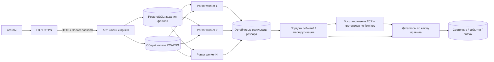

# Агенты захвата и сервер анализа

Статус: реализован первый рабочий вариант; [инструкции и ограничения](distributed.md).
Ниже сохранён проект целевой архитектуры. Текущий parser использует dpkt,
а TCP/application decoder работает внутри reducer. Состояние пока распределяется
по observation domain, дальнейшее разбиение домена по ключам правил — следующий этап.
Выполнены API, ключи, агент, Compose, параллельные parser, упорядочивание и
устойчивые checkpoints. Heartbeat API, автоматическая retention и внешний
доставщик outbox пока остаются проектными пунктами.

Уточнение требования: последовательные файлы одного агента разрешено разбирать
параллельно на разных worker. Прежняя привязка всего разбора потока к одному
worker заменена разделением декодирования и детектирования.

## Схема



Агент захватывает трафик и передаёт закрытые PCAPNG-файлы по HTTPS с отдельным
ключом. Агенту не нужны детекторы и серверные правила. Единственный внешний
HTTPS-порт 443 и сертификат обслуживает LB; внутренние API, PostgreSQL и worker
общаются в закрытой Docker-сети backend. Worker получают задания из устойчивой очереди. Задание содержит ссылку на PCAP,
а не всё бинарное тело. На одном Compose-хосте файлы доступны через общий volume;
для нескольких хостов потребуется общее файловое/объектное хранилище.

В PostgreSQL предлагается хранить реестр загрузок, задания разбора, владение
сегментами состояния, курсоры, события и outbox. Большие файлы и результаты
разбора хранятся отдельно. Этот стек реализован в `compose.yaml` и `distributed/`.

## Параллельный разбор файлов и общая история атаки

**Parser worker распределяются по файлам. Детекторы распределяются по ключам
анализируемых событий.** Эти два вида заданий имеют разные правила владения.

Например, worker 1 разбирает `agent-A/41.pcapng`, worker 2 — `agent-A/42.pcapng`.
Оба обнаруживают пакеты к `192.0.2.10`. После маршрутизации события одной цели
поступают одному владельцу её состояния. Детектор видит общую последовательность,
даже если файлы разобраны разными процессами и второй файл завершился раньше.

Файловые worker сохраняют нормализованные события с идентичностью
`(stream_id, sequence, packet_index, event_kind, sub_index)`, capture timestamp,
IP/портами/флагами, длинами и ссылкой на исходник. `sub_index` различает несколько
событий одного типа из одного пакета. Разбор не выносит окончательный вердикт
об атаке в пределах отдельного файла.

Готовый артефакт публикуется атомарно вместе с манифестом: схема, хеш, количество
событий, capture interval, версия декодера. Повторное выполнение задания
идемпотентно; частичный артефакт не считается готовым файлом. До устойчивой
фиксации результата задание не подтверждается.

### Ключи состояния

Ключ зависит от правила и области наблюдения:

| Правило | Ключ объединения | Содержимое состояния |
| --- | --- | --- |
| Распределённый DDoS | tenant + observation domain + защищаемая цель | Все источники и счётчики окна |
| SYN flood | tenant + observation domain + защищаемая цель | Нормализованные соединения, SYN/SYN-ACK и счётчики |
| Brute force | tenant + observation domain + цель + сервис | Попытки по источникам/учётным записям |
| HTTP flood | tenant + observation domain + цель + сервис | Счётчики запросов |
| C2 | tenant + observation domain + пара узлов | Временные интервалы событий |

Для первого варианта допустимо назначать одному reducer все правила защищаемой
цели. Направление пакетов нормализуется: SYN-ACK от защищаемого сервера должен
попасть в то же состояние, что и SYN к нему. Ключ только по IP атакующего
не подходит для DDoS: тогда источники одной атаки разойдутся по обработчикам.

Владение задаётся логическим shard/key с устойчивой идентичностью. Меняется
число контейнеров — shard передаётся другому процессу вместе с восстановлением
состояния. `hash(key) % текущее_число_worker` без переноса состояния не используется.
Один reducer может обслуживать много ключей, а для очень горячей цели позднее
потребуется частичная агрегация с последующим объединением.

### Второй файл разобрался раньше первого

`sequence` задаёт capture-порядок файлов, `packet_index` — порядок внутри файла.
Между parser и детекторами нужен устойчивый этап упорядочивания. Если файл 42
готов, а 41 ещё разбирается, более поздние события можно сохранять/буферизовать,
но нельзя окончательно продвигать время детектора мимо недостающего диапазона.
Пакеты из разных файлов могут потребовать сортировки по timestamp даже после
сборки sequence, особенно при PCAPNG с несколькими интерфейсами.

Продвижение времени ограничивается watermark: подтверждённой границей capture
времени, до которой учтены все ожидаемые входы. Её получают из завершённых
непрерывных последовательностей файлов, capture-интервалов и объявленного
допуска на неупорядоченность; максимальный timestamp уже разобранного пакета
сам по себе такой гарантии не даёт. Для нескольких входов учитывается минимум
их границ. Адаптер передаёт текущему `StreamingDetector` события в неубывающем
порядке, так как само ядро поздние события не поддерживает.

Буфер ограничивается диском/квотой и backpressure. Недостающий файл повторно
запускается после сбоя worker. Если источник пропал надолго, есть явный выбор:
ждать и увеличивать задержку либо отметить gap, продолжить предварительный
анализ и позднее пересчитать затронутые окна. Исключение idle-источника из
watermark тоже снижает полноту и требует политики позднего пересчёта.
Без ограничения опоздания нельзя обещать одновременно окончательный мгновенный
результат и полноту при произвольно задержанных файлах.

### Восстановление TCP и глубокий разбор

HTTP-запрос или сообщение авторизации может начинаться в файле 41 и заканчиваться
в файле 42. Независимые экземпляры TShark на этих файлах могут не распознать
сообщение целиком. Объединение готовых HTTP-событий после такого разбора уже
не восстановит пропущенное сообщение.

Для сохранения глубокого анализа нужен этап восстановления соединений:
parser выдаёт L2–L4-события/сегменты с payload или ссылкой на него; они направляются
по каноническому двунаправленному flow key к одному владельцу TCP/reassembly
состояния. Он восстанавливает прикладные сообщения и выдаёт события авторизации
и HTTP в детекторы. Метрики L3/L4 могут сразу идти в соответствующие детекторы.
У UDP/фрагментации IP также есть протоколоспецифичное состояние.

Простой вариант MVP — параллельный файловый разбор для L3/L4-детекторов,
а глубокий разбор в упорядоченном непрерывном потоке. Это ограничение должно
быть явно обозначено; независимый полный L7-разбор произвольных кусков нельзя
выдавать за эквивалент единого захвата.

### Сбой и повторная обработка

Для заданий файлов lease и номер поколения защищают публикацию результатов от
старого ожившего parser. Для reducer lease и fencing действуют на shard состояния.
Новый владелец восстанавливает checkpoint и дочитывает устойчивый журнал событий.
Нельзя начинать следующее окно с пустой RAM после переноса ключа.

Версия состояния, входной курсор, выходные события и задания outbox фиксируются
согласованно. Стабильные ID событий позволяют пережить replay без повторного
начисления пакетов и повторной записи того же alarm. Проверка прав владельца
и поколения выполняется при фиксации результата; webhook отправляет отдельный
outbox-процесс после commit. Checkpoint привязан к версии правил/схемы состояния.

### Один трафик виден нескольким агентам

Observation domain задаёт правила совместного учёта сенсоров. Для разных
неперекрывающихся участков события одной цели можно объединять. Для перекрывающихся
сенсоров сначала нужна дедупликация по согласованной модели наблюдения.
Transport event ID убирает повтор доставки, но не узнаёт один и тот же пакет,
захваченный двумя разными агентами. Рассинхронизация часов тоже входит в политику
event time и допустимых опозданий.

### Инфраструктурные роли

В Compose нужны `lb`, `api`, `postgres`, общее PCAP/event-хранилище,
`parser-worker` с N репликами и отдельно масштабируемый `detector-worker`.
Упорядочивание и маршрутизация — отдельная логическая роль, которую сначала
можно разместить в detector-сервисе. Для L7 добавляется flow/reassembly-роль.
Малый MVP может совмещать роли в одном образе с разными командами запуска.

Kafka с partition по ключу детектора и consumer group — возможный транспорт
нормализованных событий при росте нагрузки. Он помогает назначать владельцев
partitions и хранить журнал для replay. Порядок поступления в broker не заменяет
capture-порядок: sequence, watermark, восстановление состояния и дедупликация
результатов нужны независимо от выбранной очереди.

## Захват и доставка

1. Агент запускает один `dumpcap` на выбранный интерфейс и пишет PCAPNG-файлы.
   Стартовые параметры для испытаний: ротация каждые 2 секунды или 16 MiB,
   что наступит раньше. Низкий трафик проверяется отдельно: фактическая задержка
   закрытия файла зависит от поведения capture backend. Для активного файла
   передача не начинается.
2. `dumpcap -b printname:...` позволяет получить имя уже закрытого файла.
   После закрытия агент вычисляет SHA-256, фиксирует размер и присваивает
   `(stream_id, sequence)`. Запись очереди должна переживать перезапуск процесса.
3. Один поток отправляется последовательно, разные потоки — с ограниченной
   параллельностью. Тело запроса читается из файла, не загружается целиком в RAM.
4. Сервер проверяет ключ и лимит запроса до чтения тела, пишет временный файл,
   проверяет фактический размер, SHA-256 и формат, затем фиксирует приём.
   Подтверждение выдаётся только после устойчивого сохранения файла и записи
   реестра. Нужны `fsync` файла, атомарное переименование и синхронизация каталога;
   очередь должна восстанавливаться из реестра после сбоя. Файл и PostgreSQL не имеют
   общей транзакции: незавершённые записи и файлы без записи сверяются при старте.
5. Агент удаляет файл только после положительного ответа сервера с совпадающим
   идентификатором и хешем. Потерянный ответ приводит к повтору того же запроса.
6. Сетевые ошибки, `429` и временные `5xx` повторяются с exponential backoff,
   jitter и ограничением частоты. `Retry-After` учитывается. `401/403` требуют
   обновления ключа; конфликт содержимого не ретраится бесконечно.

Размер 16 MiB является пределом захваченных данных для ротации, а не точным
размером HTTP-запроса: PCAPNG имеет заголовки, а последний пакет может выйти
за порог. Предлагаемый серверный предел запроса — 32 MiB. Превышение возвращает
`413`, фиксируется как ошибка конфигурации и требует меньшего размера ротации;
агент не режет PCAPNG произвольно на байты.

Кольцевой буфер с перезаписью неподтверждённых файлов **не используется**.
На агенте задаются квота очереди (например, 2 GiB) и резерв свободного места.
При заполнении агент останавливает захват, сохраняет уже записанное и отмечает
пробел мониторинга. После освобождения места захват возобновляется с новым
capture epoch. Если позднее появится режим удаления старых файлов, его потеря
данных должна явно отображаться в метриках и событиях.

Трафик отправителя нужно исключить из захвата: иначе агент начнёт захватывать
собственные загрузки PCAP. Предпочтителен отдельный интерфейс управления;
для общего интерфейса используется capture filter, исключающий адреса и порт
сервера приёма. При изменении DNS/IP сервера фильтр обновляется.

## Ключи и идентичность

- Администратор создаёт агенту отдельный случайный ключ с секретом не менее
  256 бит. Общего ключа для всех машин нет. Формат: `<key_id>.<secret>`.
- Ключ передаётся только в `Authorization: Bearer ...` по HTTPS с проверкой
  сертификата. Он не попадает в URL, PCAP-метаданные и логи.
- Сервер хранит `key_id`, SHA-256 высокоэнтропийного секрета, `agent_id`,
  разрешённые потоки/квоты, даты создания/отзыва. Проверка digest — сравнением
  постоянного времени. Человеческие пароли этим способом хранить нельзя.
- Идентичность определяется проверенным ключом. Переданный клиентом `agent_id`
  не позволяет писать от имени другого агента.
- Агент читает ключ из файла с правами `0600`, а не аргумента CLI. Выпуск ключей
  — отдельная административная операция, недоступная через endpoint загрузки.
- Ротация допускает короткое перекрытие двух ключей одного агента; отзыв одного
  ключа не меняет `stream_id` и не теряет очередь агента.
- API-ключ ограничивает право загрузки. Доступ к просмотру захватов и управлению
  ключами отделён. Для более строгого окружения предусматривается mTLS.
- Ограничиваются размер тела, скорость запросов, объём диска и число задач
  на агента. Разбор недоверенного PCAP идёт непривилегированным worker-процессом
  с лимитами CPU/RAM/времени, отдельно от процесса HTTP-приёма.

## Минимальный контракт API

Предлагаемые маршруты:

| Запрос | Назначение |
| --- | --- |
| `POST /v1/streams` | Зарегистрировать интерфейс и capture epoch; получить `stream_id`, лимиты и ожидаемый sequence |
| `PUT /v1/streams/{stream_id}/chunks/{sequence}` | Передать закрытый PCAPNG-файл |
| `GET /v1/streams/{stream_id}/status` | Узнать непрерывный подтверждённый и проанализированный sequence |
| `POST /v1/heartbeat` | Передать состояние захвата, очередь, drops и версию агента |

Для `PUT`: `Content-Type: application/octet-stream`, `Content-Length`,
`X-Content-SHA256`, `Authorization`. Первый sequence равен 0. UUID потока
генерируется агентом для идемпотентной регистрации и связывается сервером с авторизованным агентом. Имя файла от клиента
не используется как путь на сервере.

Пример успешного ответа:

```json
{
  "stream_id": "8f4828ac-cb87-4b14-ab44-5ff46bb1831e",
  "sequence": 42,
  "sha256": "<64 hex characters>",
  "stored": true,
  "analysis_status": "queued"
}
```

- `201` — новый файл устойчиво сохранён; `200` — тот же sequence с тем же
  содержимым уже сохранён. Совпадение проверяется по хешу и размеру.
- `409` — тот же sequence с другим содержимым; сохранённый файл не заменяется.
- `401/403` — недействительный ключ/чужой поток; `413` — слишком большой файл;
  `429` — превышена квота; `503` — сервер временно не может сохранить данные.
- Подтверждение загрузки не означает, что анализ окончен. Ошибки декодирования
  отражаются в статусе задачи, а исходный PCAP сохраняется для расследования.

## Непрерывность и хранение

В новой схеме историю атак сохраняют reducer по ключам правил, а история TCP
сохраняется в flow-этапе. Файловые parser можно переносить и выполнять параллельно.
Исходники, артефакты и журнал, нужные для восстановления или пересчёта поздних
окон, не удаляются retention-задачей до безопасного checkpoint/курсора.

Сроки хранения исходных PCAP, нормализованных событий и отчётов настраиваются
отдельно. Квоты очереди, задержка watermark, пробелы источников и ошибки разбора
видны в статусе. При перегрузке растут устойчивый backlog и задержка, а память
ограничивается backpressure и лимитами артефактов.

## Ёмкость и метрики

Передача полного PCAP не снижает объём наблюдаемого трафика. При 100 Mbit/s
полезных захваченных данных получается примерно 12.5 MB/s или 1.08 TB/сутки
на один агент, без учёта PCAPNG/TLS-заголовков. Значит, 2 GiB дисковой очереди
хватит примерно на 172 секунды при такой скорости. Сжатие опционально после
замеров: его эффект зависит от содержимого, а CPU и лимиты распаковки нужны
в любом случае.

Измерять отдельно: capture packets/drops, bytes captured, длительность и размер
файлов, очередь агента в байтах и возраст старейшего файла, upload throughput,
повторы, auth failures, приёмный backlog, время декодирования, packets/s анализа,
RAM worker, задержку capture→alarm и пробелы наблюдения.

## Последовательность реализации

1. Потоковое ядро и тесты границ окон — выполнено в текущем изменении.
2. API приёма, реестр ключей, устойчивое сохранение и идемпотентные загрузки.
3. Агент с `dumpcap`, восстановлением очереди, квотами и повторами отправки.
4. Параллельные parser, устойчивые результаты, упорядочивание и reducer по ключам.
5. Восстановление протоколов на границах файлов, checkpoint/replay и дедупликация.
6. Сквозные испытания: неверный/отозванный ключ, retry после потери ответа,
   рестарт агента/сервера/worker, заполнение диска, отсутствующий sequence,
   атака на границе файлов, неверный PCAP и длительный нагрузочный прогон.

## Источники для проектных решений

- [Wireshark: dumpcap](https://www.wireshark.org/docs/man-pages/dumpcap.html) —
  ротация, уведомление о закрытых файлах и ограничения capture buffer.
- [OWASP: REST Security](https://cheatsheetseries.owasp.org/cheatsheets/REST_Security_Cheat_Sheet.html) —
  HTTPS, проверка ключа для защищённых запросов, отзыв и ограничения запросов.

- [PostgreSQL: SELECT / SKIP LOCKED](https://www.postgresql.org/docs/current/sql-select.html) —
  выборка элементов очереди несколькими исполнителями без ожидания занятых строк.
- [Apache Kafka: consumer groups](https://github.com/apache/kafka/blob/trunk/clients/src/main/java/org/apache/kafka/clients/consumer/KafkaConsumer.java) —
  единственный consumer partition в группе и перераспределение при изменении состава.

- [Apache Flink: event time и watermarks](https://nightlies.apache.org/flink/flink-docs-master/docs/concepts/time/) —
  обработка опозданий и компромисс задержки и полноты.
- [Kafka Streams: partitioning и state stores](https://kafka.apache.org/26/streams/architecture/) —
  распределение по ключам и восстановление локального состояния.
